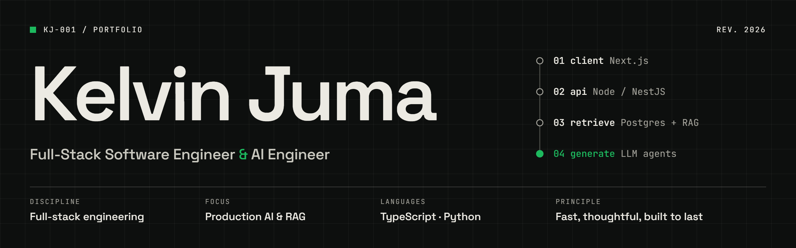

 

&nbsp;

&nbsp;

 

Building fast, reliable web applications and AI-powered products with modern JavaScript, TypeScript, Python, and LLM technologies.

 

---

## About

- Building scalable web applications with **React**, **Next.js**, **Node.js**, and **Python**
- Designing robust APIs, relational databases, and maintainable backend architectures
- Shipping production-ready AI features with **OpenAI**, **LangChain**, **RAG**, and intelligent agent workflows
- Passionate about clean architecture, performance, and exceptional user experiences
- Continuously learning, and shipping software that solves real-world problems

 

---

## Current focus

|                     |                                                       |
| :------------------ | :---------------------------------------------------- |
| **AI applications** | Production-ready apps powered by LLMs                 |
| **Retrieval**       | Reliable Retrieval-Augmented Generation (RAG) systems |
| **Agents**          | Intelligent agent workflows with LangChain            |
| **TypeScript**      | Cleaner, scalable code across large codebases         |
| **Architecture**    | Modern software design and cloud-native development   |

 

---

## Stack

#### Frontend

#### Backend

#### Databases

#### AI & Machine Learning

#### Developer Tools

---

<!--
## Featured projects
Uncomment and fill in once you've picked your best work (or pin 4–6 repos instead).

| Project | What it does | Stack |
|:--|:--|:--|
| [**Project name**](https://github.com/talesofcarter/repo) | One sentence on the problem it solves | `Next.js` `Postgres` |
-->

## Activity

 

<picture>
  <source media="(prefers-color-scheme: dark)" srcset="https://streak-stats.demolab.com?user=talesofcarter&theme=dark&hide_border=true">
  
</picture>

 

---

 

<em>Building software that is fast, thoughtful, and built to last.</em>

  

